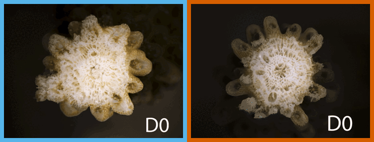
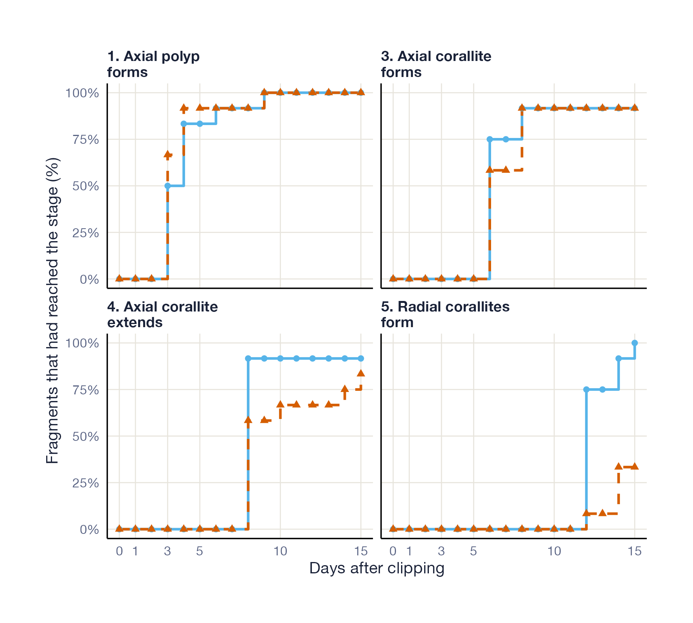
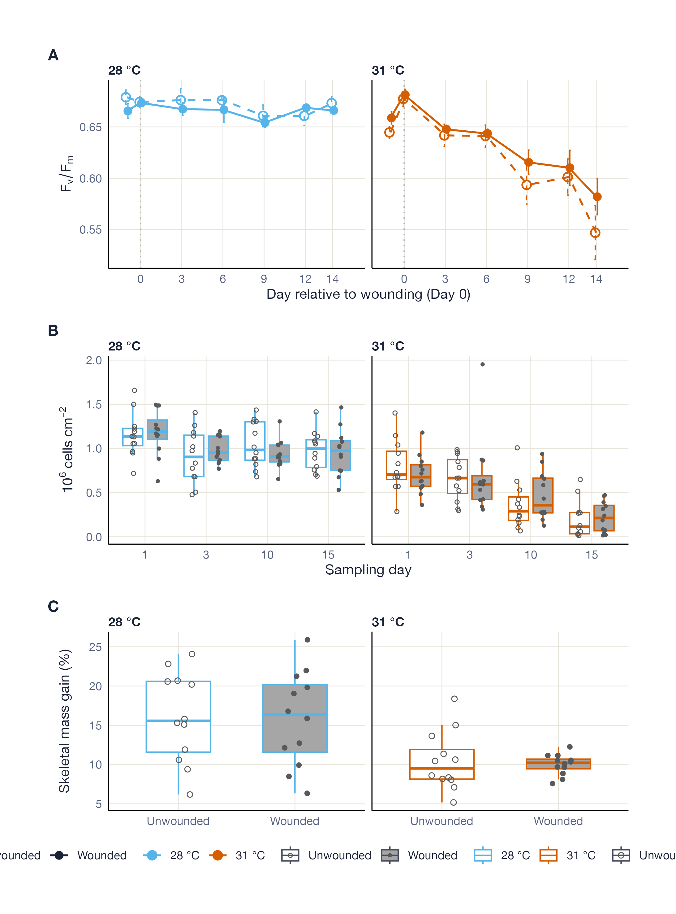

# Heat and wound repair in *Acropora* cf. *pulchra*

Does a few weeks of warmer water stop a coral from repairing a broken branch tip? We held 192 fragments of *Acropora* cf. *pulchra* from Mo'orea, French Polynesia, at 28 °C or 31 °C, wounded half of them by clipping off the growing tip, and followed healing, regeneration and coral condition for 15 days.

**[Read the results summary →](https://stier-lab.github.io/acropora-long-term-heat-expression/team_summary/LTH_results_summary.html)**

<p align="center">
  <br>
  <sub>Two wounded tips, Day 0 to Day 15. Both heal and grow a new tip; only the 28 °C fragment (left) forms new radial corallites.</sub>
</p>

## What we found

- **Wounded tips healed at both temperatures.** Tissue covered the wound within a day, and nearly every fragment grew a new axial polyp and corallite.
- **Heat blocked the last regeneration step.** By Day 15, 12 of 12 wounded fragments at 28 °C had formed new radial corallites (the side cups on a regrown tip), against 4 of 12 at 31 °C. The split was the same in every tank.
- **Heat lowered coral condition.** At 31 °C, fragments paled, their symbionts used light less efficiently (Fv/Fm 0.56 vs 0.67 on Day 14) and they lost most of their algal symbionts (0.21 vs 0.97 million cells per cm² on Day 15).
- **Heated fragments grew less**, 10.2% vs 16.0% skeletal mass over 15 days. This is the weakest result, because one ambient tank grew about as little as the heated tanks.
- **Wounding did not make heat stress worse**, and **fragments from source patch C were affected least**.

<p align="center">
  <br>
  <sub><b>Figure 1B.</b> Share of wounded fragments (12 per temperature) that had reached each regeneration stage by each day. Blue = 28 °C, orange = 31 °C.</sub>
</p>

<p align="center">
  <br>
  <sub><b>Figure 2.</b> Photosynthetic efficiency (A), symbiont density (B) and skeletal growth over 15 days (C). Blue = 28 °C, orange = 31 °C; open symbols and white boxes = unwounded, filled and gray = wounded. Full legend: <code>manuscript/FIGURE_2_LEGEND.md</code>.</sub>
</p>

## The experiment

| | |
|---|---|
| **Corals** | 192 unbranched fragments, about 6 cm tall, collected 18–19 May 2025 in northwest Mo'orea from three field source patches (A, C and D). Source patches are collection spots, not confirmed genotypes. |
| **Temperature** | Eight tanks at Gump Station: four at 28 °C (tanks 3, 6, 9, 12) and four raised to 31 °C over 28–31 May (tanks 4, 5, 10, 11). |
| **Wounding** | On Day 0 (4 June) we clipped about 1 cm off the growing tip of half the fragments in every tank. |
| **Sampling** | 144 fragments sampled on Days 1, 3 and 10 for RNA-seq; 48 followed daily and sampled on Day 15. A separate 16-fragment experiment was photographed daily under a microscope. |

## Run the analysis

```bash
Rscript -e 'renv::restore()'   # once: installs the pinned package versions (R 4.6.2)
Rscript code/run_all.R         # a few minutes; rebuilds every number, table and figure
```

Every number in the text comes from `output/paper/*_numbers.csv`, so change the code and rerun rather than editing numbers by hand. [`docs/HOW_TO_CHANGE.md`](docs/HOW_TO_CHANGE.md) walks through it.

## What's where

| Folder | Contents |
|---|---|
| [`code/`](code/) | Nine numbered scripts (`00_setup.R` to `08_checks.R`) and `run_all.R`. See [`code/README.md`](code/README.md). |
| [`data/`](data/) | Raw exports from Google Drive (never hand-edited), codebooks and cleaned data |
| [`output/`](output/) | Tables and the numbers used in the text (`output/paper/`) |
| [`figures/`](figures/) | Every figure as PDF and PNG; the catalog is [`figures/FIGURE_INDEX.md`](figures/FIGURE_INDEX.md) |
| [`manuscript/`](manuscript/) | Which figure goes where in the draft, and the Figure 2 legend |
| [`docs/`](docs/) | Results summary, [glossary](docs/GLOSSARY.md), data notes, model checks and the RNA-seq plan |

Raw sheets, field notes and the manuscript draft live in the project's Google Drive folder; photos are on the lab NAS; RNA-seq processing is at UC Davis (Bay lab).

## Citation and license

Use GitHub's **Cite this repository** button (from [`CITATION.cff`](CITATION.cff)). Code is MIT-licensed, data CC BY 4.0 and images CC BY-NC 4.0. Fieldwork was done at the UC Berkeley Gump Research Station, Mo'orea, with NSF support.
