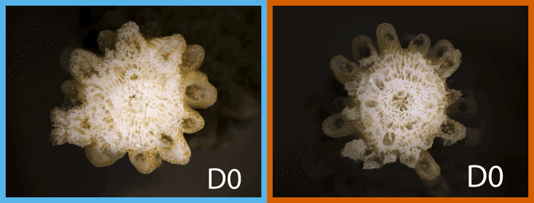

# LTH: heat × wounding in *Acropora* cf. *pulchra*

A 15-day experiment at Gump Station, Mo'orea (May–July 2025). Fragments were held at 28 °C or 31 °C in four tanks per temperature; half had about 1 cm clipped from the growing tip on Day 0. We tracked wound healing and regrowth, photosynthesis efficiency (Fv/Fm), color, symbiont density and skeletal growth, and collected tissue for RNA-seq.

<p align="center">
  <br>
  <sub>Both temperatures re-cover the wound and rebuild a tip; by Day 15 the 31 °C fragment has not budded new corallites.</sub>
</p>

## Start here

| Need | File |
|---|---|
| Results in plain language | `docs/team_summary/LTH_results_summary.html` |
| Every number reported in the text | `output/paper/*_numbers.csv` |
| Which figure is which in Molly's draft | `manuscript/MAIN_FIGURE_PLAN.md` |
| How the code is organized | `code/README.md` |
| Which outputs are current | `docs/OUTPUTS_STATUS.md` |
| Model checks | `docs/diagnostics/MODEL_DIAGNOSTICS_2026-11-11.md` |
| Data caveats and collaborator notes | `docs/DATA_NOTES.md` |

## Run it

```bash
Rscript -e 'renv::restore()'   # once: installs the pinned package versions
Rscript code/run_all.R         # about a minute; rebuilds every number, table and figure
```

Package versions are pinned in `renv.lock` (R 4.6.2). Restore them before rerunning: the simulation-based residual checks (DHARMa) give different outlier sets under other versions. Never hand-edit numbers; change the code and rerun. A few exploratory analyses are kept in `extras/` and are not run; older deprecated material was removed on 2026-11-13 (tag `pre-prune-2026-11-13`).

## Design

| Factor | Levels |
|---|---|
| Temperature | 28 °C and 31 °C, ramped 1 °C per day. Tanks 3, 6, 9, 12 (28 °C) and 4, 5, 10, 11 (31 °C). |
| Wound | About 1 cm clipped from the tip on Day 0, or not clipped |
| Source patch | A, C and D (Mahana/Tiahura, NW Mo'orea). Stored as `thicket`, or `genet` in older names. These are field labels, not genotypes. |
| Sampling | 192 fragments in the main experiment: 144 sampled on Days 1, 3 and 10 (the RNA-seq libraries) and 48 followed daily, then sampled on Day 15. A separate 16 wounded fragments were photographed under a microscope. |

## Folders

| Path | Contents |
|---|---|
| `code/` | The ten core scripts and `run_all.R` |
| `data/raw/` | Exports from Google Drive; never hand-edited. Codebooks are in `data/metadata/`. |
| `data/external/` | Collaborator and published reference tables (Cunning et al. 2024; Trinity Conn's Hauru colonies) |
| `output/`, `figures/` | Everything the code writes; figures are listed in `figures/FIGURE_INDEX.md` |
| `manuscript/` | Figure map, Figure 2 legend, `references.bib` |
| `docs/` | Team summary, diagnostics, data notes, RNA-seq plan, Drive method exports |
| `literature/` | `library_map.csv` (citation, theme and file name for each reference). The PDFs live on Google Drive, not in this public repo (see `literature/README.md`). |
| `extras/` | Three small exploratory analyses kept for context (see `extras/README.md`) |
| `tools/` | `check_output_changes.py`, which sorts real output changes from rerun noise |

Google Drive (`17. LTH_expression_by_temperature_2025`, ID `1sXfnHN-vmSBuwMEfERiYOWDeKRmjFWJP`) holds the raw Sheets, field notes and Molly's manuscript draft. Photographs are on the lab NAS (see `docs/DATA_NOTES.md`). RNA-seq processing is at UC Davis (Bay lab).

## License and funding

Code MIT · data CC-BY 4.0 · images CC BY-NC 4.0 · manuscript all rights reserved. NSF support to the project investigators; fieldwork at the UC Berkeley Gump Research Station.
